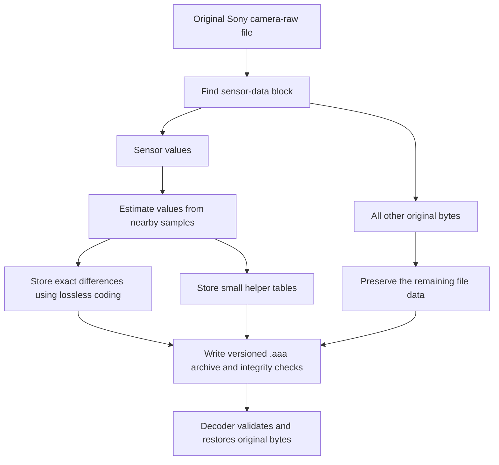

# Lossless ARW Archive Codec

A Rust command-line tool and library for losslessly archiving supported Sony
ARW2 camera-raw files. It restores the exact original file bytes.

The command-line tool writes `.aaa` files using this project's own versioned
container. The container identifier `AAA1` is a project-created label, not an
industry standard or part of Sony's ARW specification. Most users only need to
know that the decoder checks the archive and restores the original file.

## Build and use

```sh
cargo build --locked --release

# One file
target/release/arw-archive pack input.ARW output.aaa
target/release/arw-archive unpack output.aaa restored.ARW

# Directories
target/release/arw-archive compress originals archives
target/release/arw-archive verify originals archives
target/release/arw-archive decompress archives restored
```

`verify` restores each archive in memory and compares every byte with the
original. ARW2 files use a TIFF-based structure. This codec supports specific
sensor-data layouts; it reports unsupported layouts rather than guessing.

## What happens to a file

The codec locates the block of bytes that stores sensor values, and separates
it from the rest of the file. It predicts each value from nearby values, then
stores the difference between the prediction and the actual value. Common
differences are stored compactly; unusual ones are still represented exactly.
The decoder reverses these steps. The original bytes outside the sensor block
are preserved too.

The predictor is a rule for estimating a value from nearby samples. An adaptive
range coder is a lossless packing method that gives shorter bit sequences to
differences seen often, and updates its frequency estimates as it processes the
file. Small helper tables are stored with the archive so decoding can repeat
the same predictions.



The `.aaa` file has small version and codec markers so a decoder knows how to
read it. They are internal compatibility tags, not settings or quality
ratings. See [`docs/FORMAT.md`](docs/FORMAT.md) for the byte layout
and rules for future versions.

For a lower-level view of the modules and data flow, see the
[implementation architecture diagram](docs/implementation/ARCHITECTURE.md).

## Example compression results

An eight-worker run over 98 Sony ARW2 files produced:

| Measurement | Result |
|---|---:|
| Original data | 2,441,740,288 bytes |
| Archives | 1,919,595,066 bytes |
| Archive size as a share of input | 78.62% |
| Space saved | 21.38% |
| Total elapsed time | 59.161 s |
| Per-file packing time: median | 6.782 s |
| Per-file packing time: 90th percentile | 7.255 s |
| Per-file packing time: 95th percentile | 7.343 s |
| Per-file packing time: 99th percentile | 7.446 s |
| Per-file packing time: minimum–maximum | 5.337–7.446 s |

Per-file times overlap because eight files were processed concurrently. This
run skipped verification; use the `verify` command to compare restored bytes
with the originals. The 90th percentile means 90% of files took that long or
less. Results depend on the computer and input files.

## Library integration

Build the Rust library for use from other programs:

```sh
cargo build --locked --release -p arw-archive
```

On GNU/Linux this produces a shared library (`libarw_archive.so`) and a static
library (`libarw_archive.a`). A shared library is loaded by an application at
runtime; a static library is linked into it at build time. The C header at
[`src/arw-rust/include/arw_archive.h`](src/arw-rust/include/arw_archive.h)
provides an interface to the Rust codec; it is not a separate C implementation.
See [`docs/INTEGRATION.md`](docs/INTEGRATION.md) for Rust and C
integration examples.

The crate can also be used directly from Rust through Cargo:

```toml
arw-archive = { git = "https://github.com/OWNER/REPOSITORY.git" }
```

Replace the example URL with the repository location before using it.

## Development and contributions

```sh
cargo fmt --all -- --check
cargo test --locked
```

To stage only the public Rust project files, run `./prepare-git.sh` from the
root of a fresh public copy, then review the staged changes before committing.
Do not run it in this development repository: its existing Git history
contains a private optimization notebook. The script refuses to stage when it
detects that history; removing the notebook from the index cannot remove it
from older commits.

Contributions are welcome. Useful areas include improving the predictor,
reducing archive size or packing time, adding supported ARW2 layouts, and
improving platform support. Please include round-trip tests and report both
complete archive size and repeatable timing results.

## License

MIT. See [`LICENSE`](LICENSE).

The codec was generated by GPT Astra, Terra and Luna.
