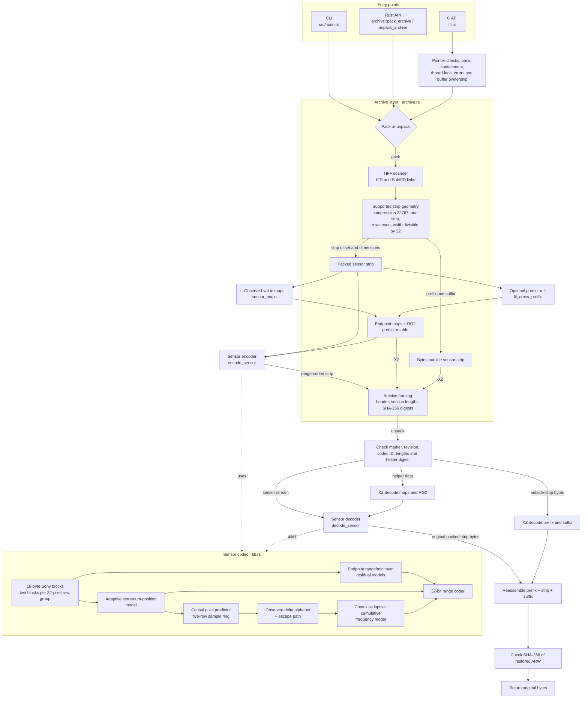

# Implementation architecture

This diagram follows one file through the Rust crate. It focuses on module
boundaries and the data passed between them; the archive byte layout is in
[FORMAT.md](../FORMAT.md).

## Why the pieces are separate

- The archive layer owns TIFF discovery, section framing and file integrity.
  The sensor codec only transforms the supported strip.
- Endpoint maps and the optional `RG2` table are derived from the strip and
  stored as helper data. The decoder reads them first so it can reproduce the
  encoder's ranks and predictor choices.
- The sensor pass immediately reconstructs samples and updates its predictor
  and adaptive models. Encoder and decoder share this pass so their state
  remains synchronized without storing a full sample image in the archive.
- The final digest verifies exact restoration of the input ARW. It does not
  reverse any lossy compression already applied by the camera.
